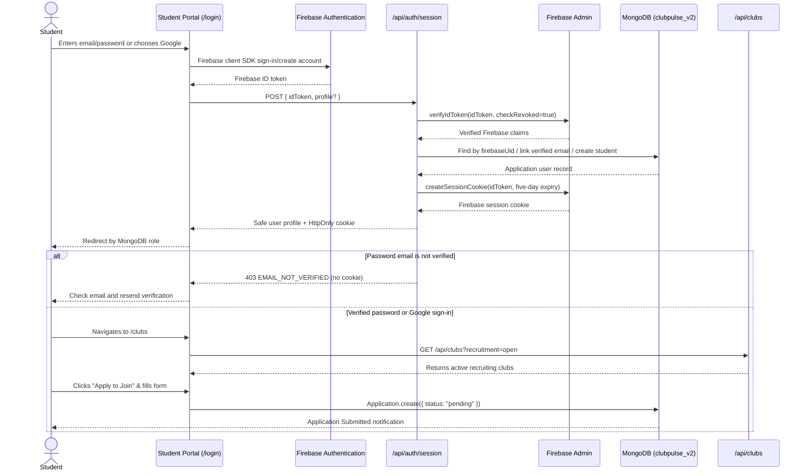
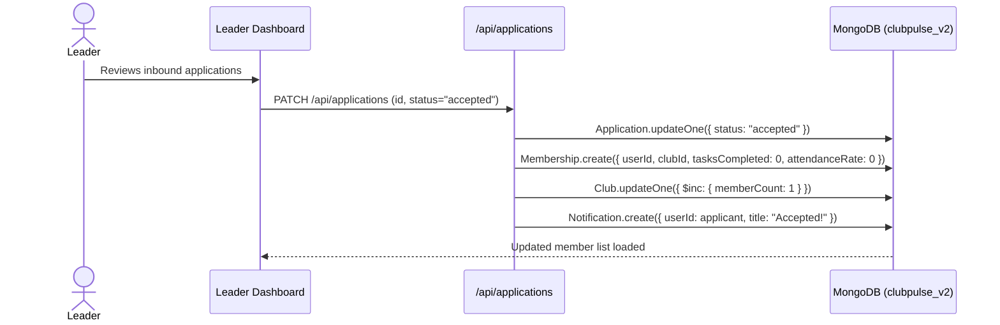
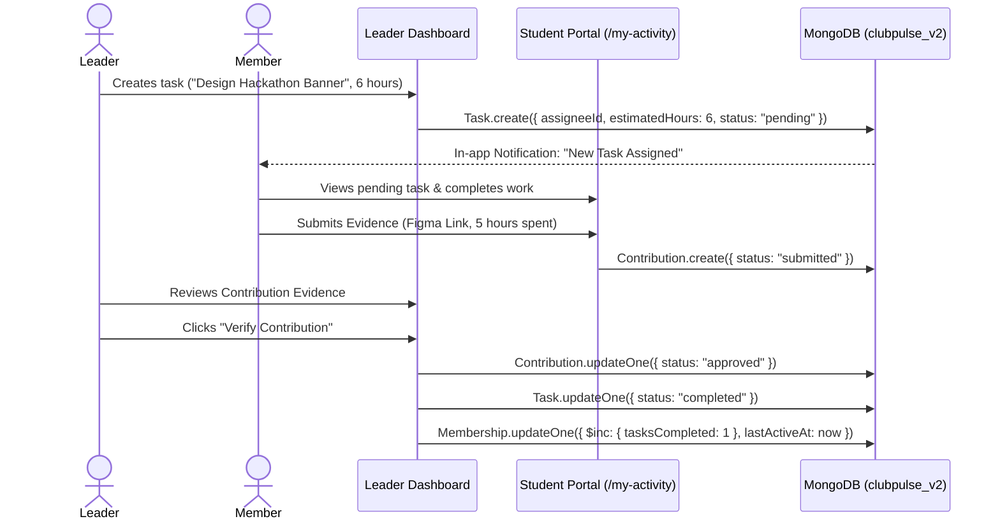
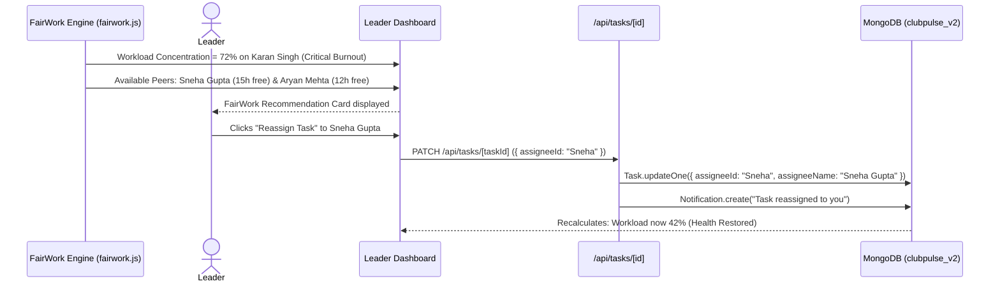
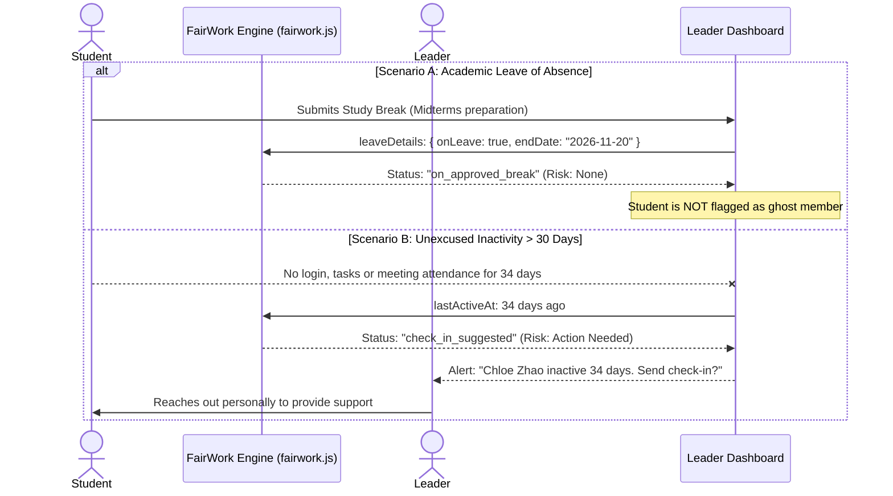

# ClubPulse — End-to-End Workflow & User Journeys

---

## 1. Journey 1: Firebase Enrollment & Club Joining

---

## 2. Journey 2: Club Officer Application Review & Onboarding

---

## 3. Journey 3: Task Assignment, Evidence Submission & Verification

---

## 4. Journey 4: FairWork Workload Rebalancing Workflow

---

## 5. Journey 5: Ghost Member Detection & Academic Leave Exemption

